# Diagramas de Atividade do MaphiApp
## 1. Fluxo geral da aplicacao
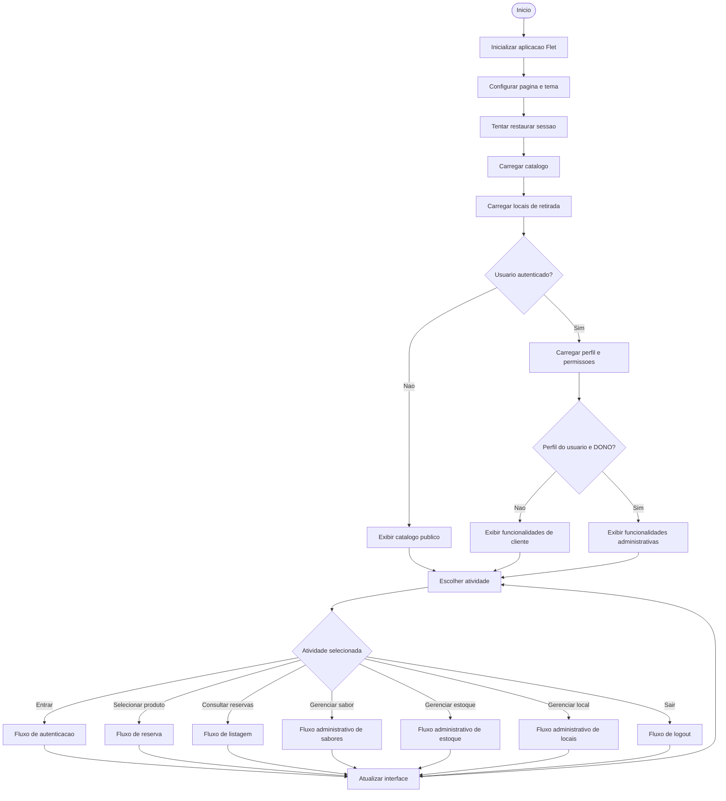
## 2. Inicializacao e restauracao da sessao
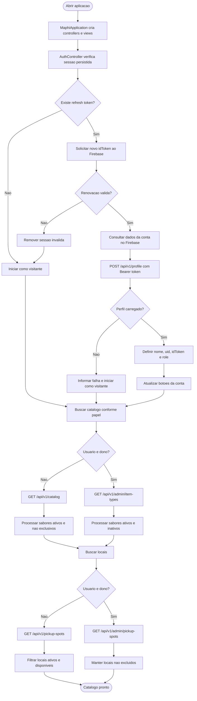
## 3. Autenticacao
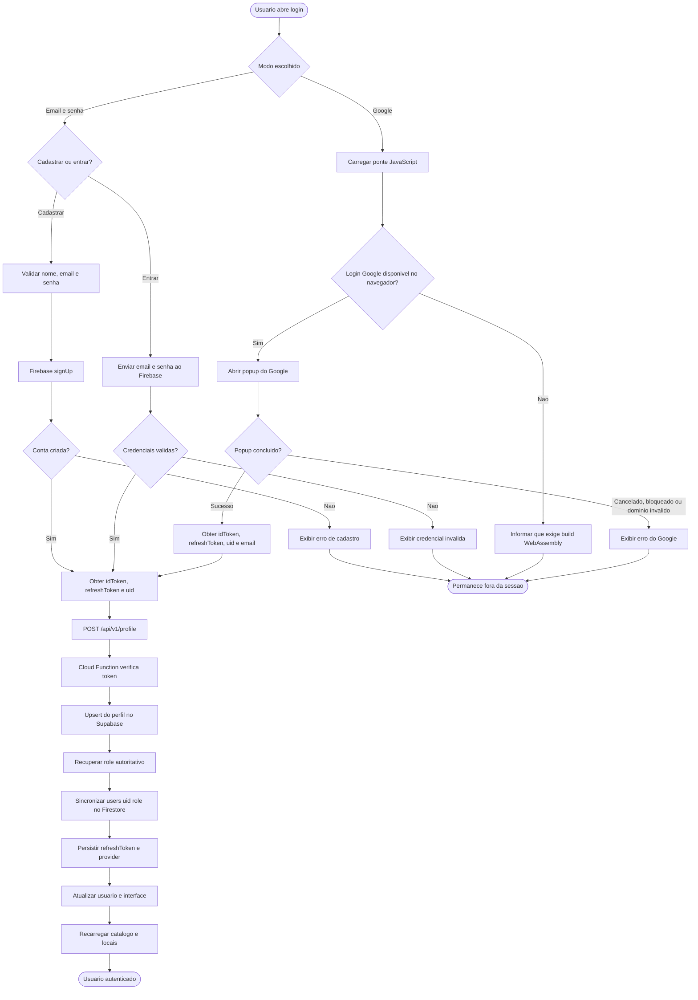
## 4. Logout
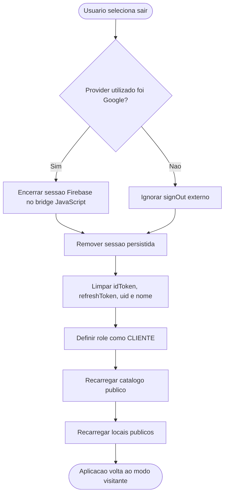
## 5. Navegacao e selecao no catalogo
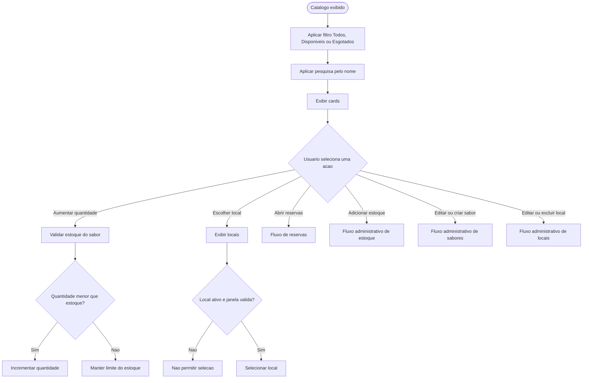
## 6. Criacao de reserva
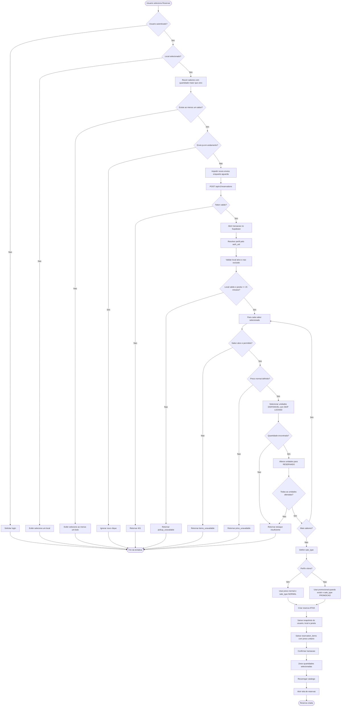
## 7. Cancelamento, conclusao e exclusao logica de reservas
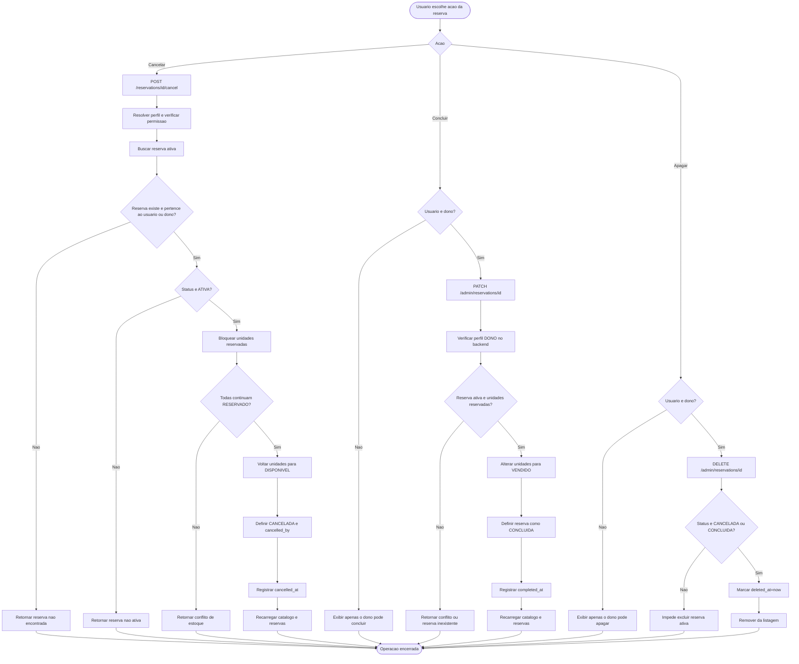
## 8. Gerenciamento de estoque
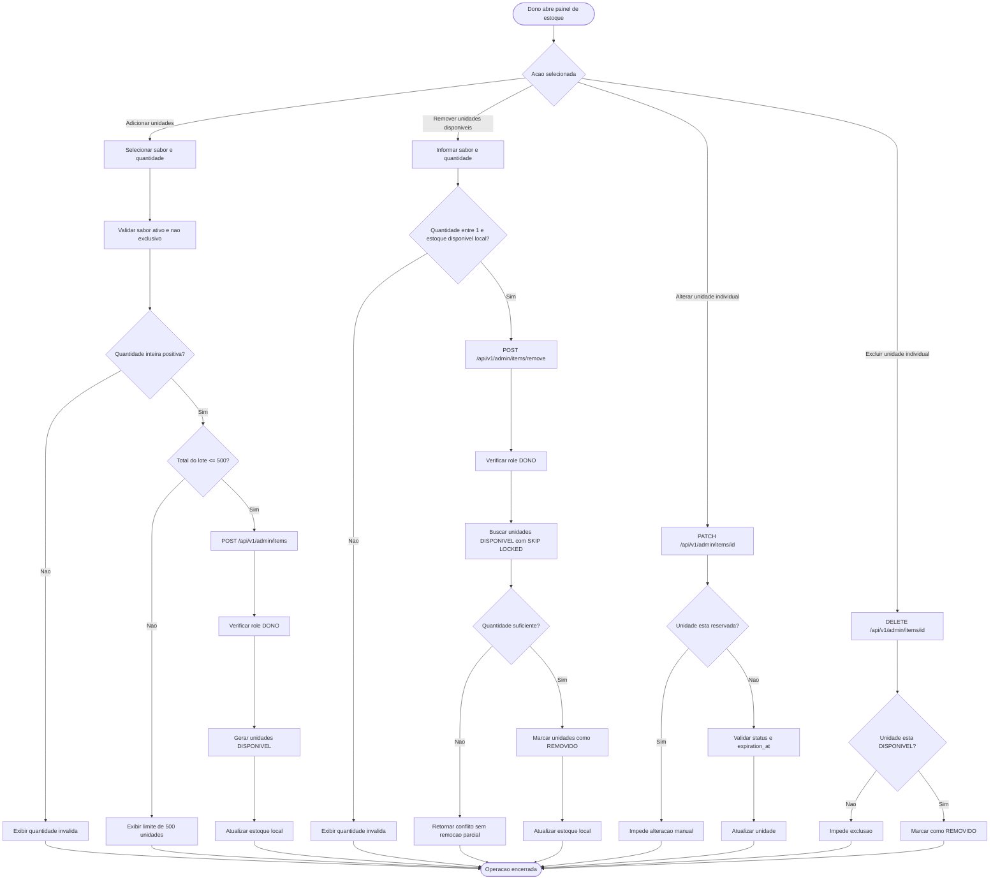
## 9. Gerenciamento de sabores
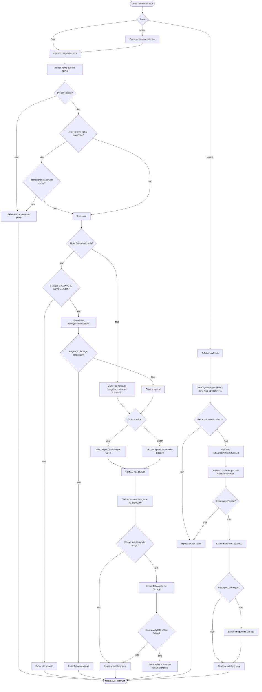
## 10. Gerenciamento de locais de retirada
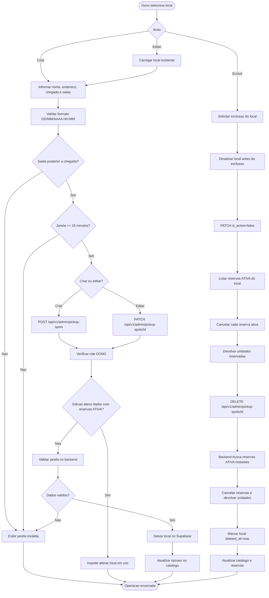
## 11. Listagem de reservas
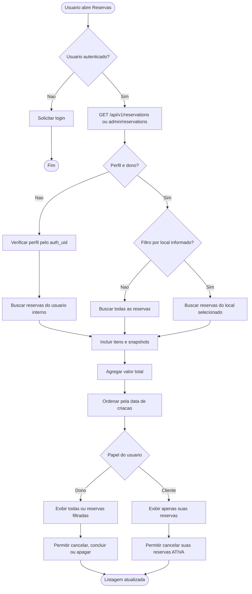
## 12. Tratamento de uma requisicao da Cloud Function
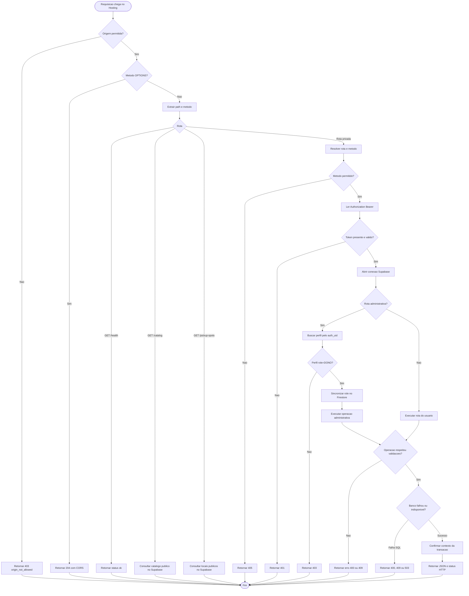
## 13. Pipeline de CI/CD
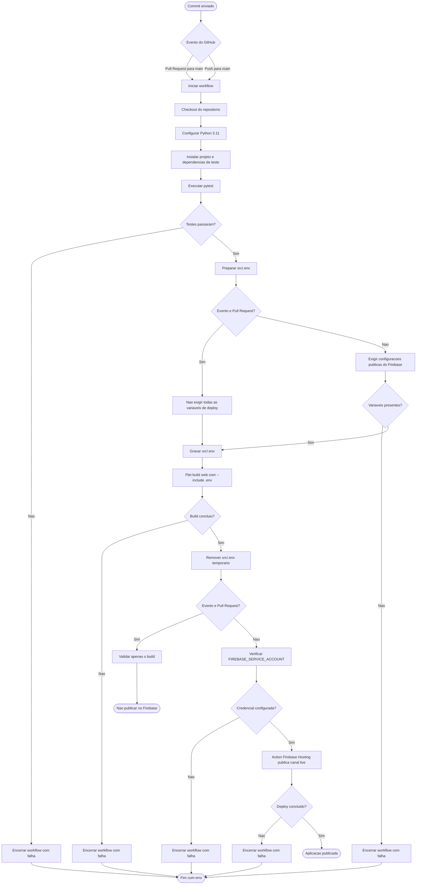
