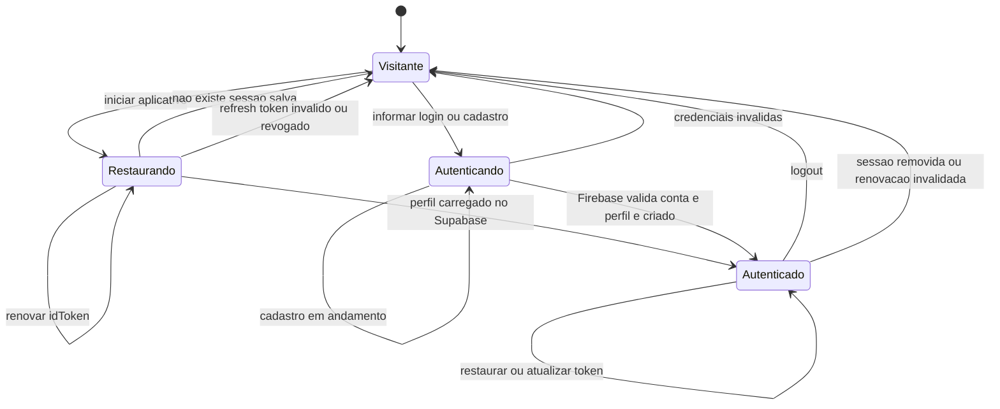
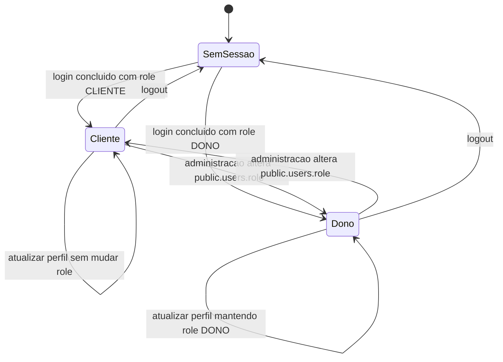
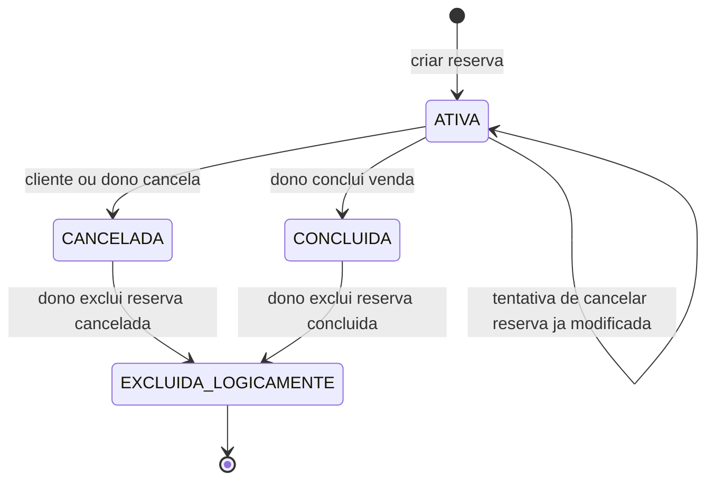
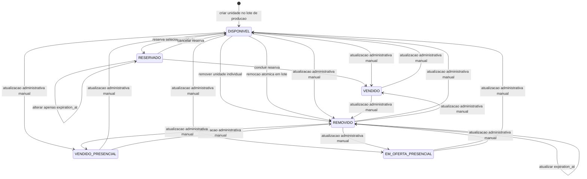
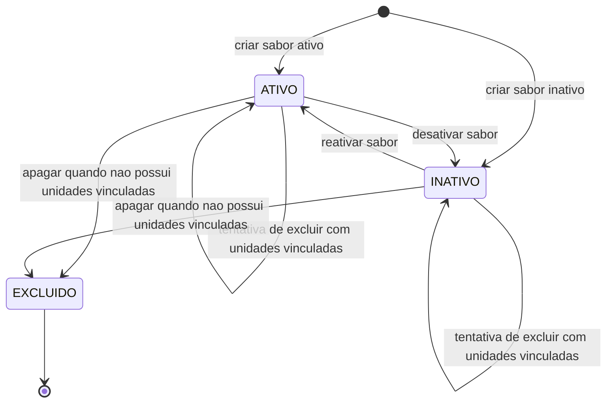
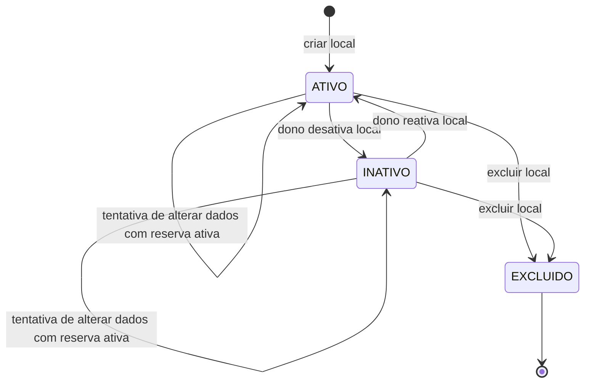
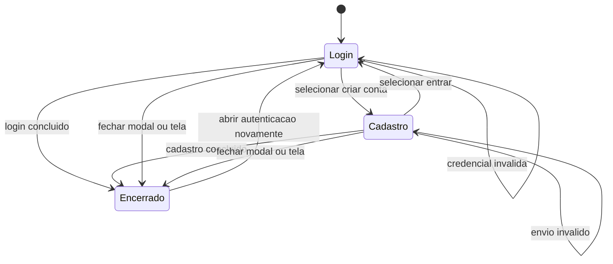
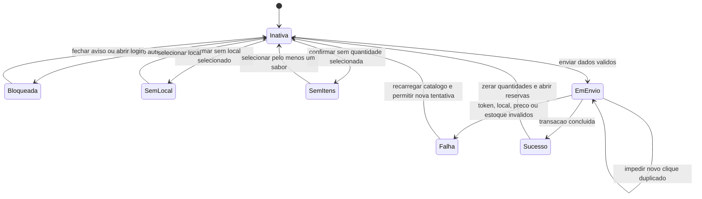

# Diagramas de Estado do MaphiApp
## 1. Sessao de autenticacao

## 2. Papel do usuario

## 3. Reserva

## 4. Unidade fisica no estoque

## 5. Sabor do catalogo

## 6. Local de retirada

## 7. Formulario de autenticacao

## 8. Operacao de criacao de reserva no cliente

